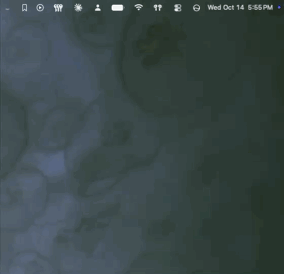
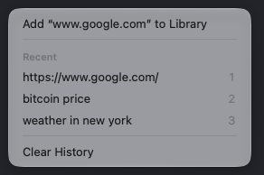
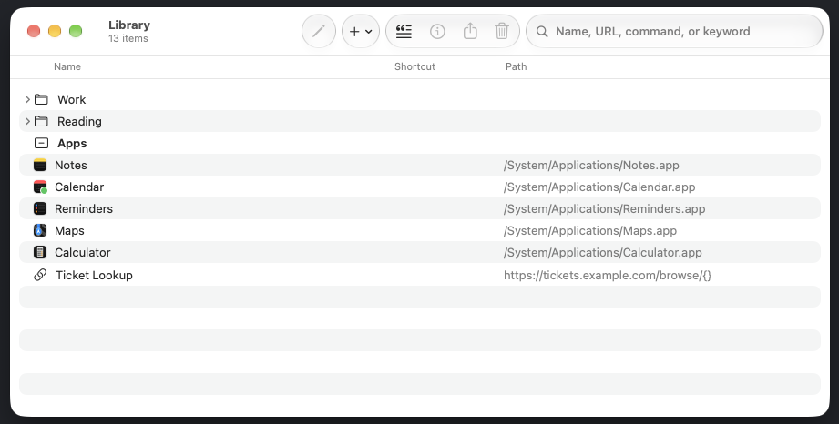
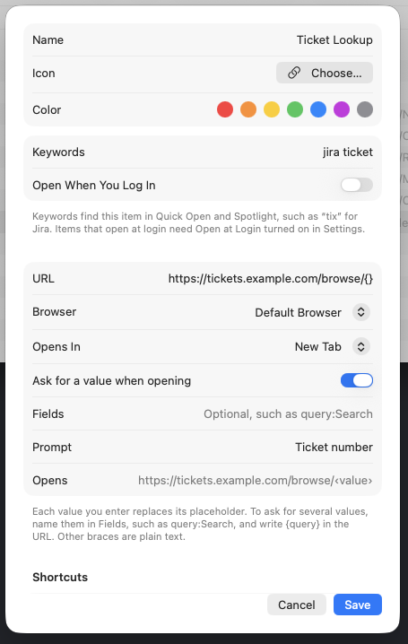
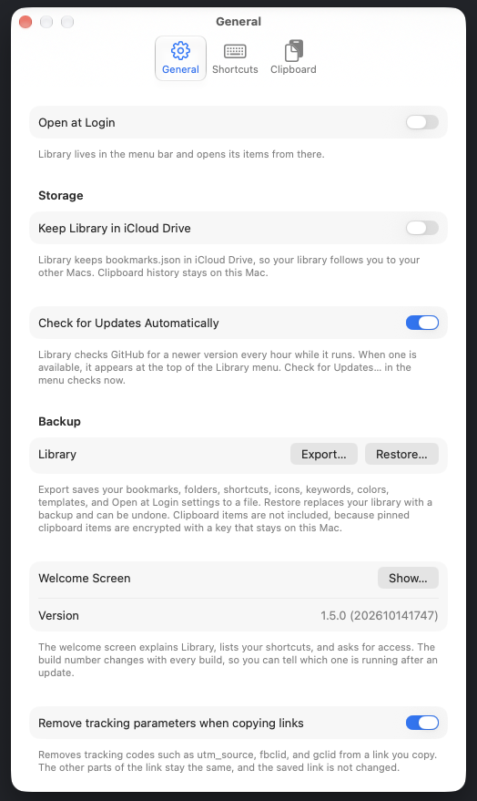

<div align="center">


<h1>Library</h1>

<p><strong>Everything you open and copy, one shortcut away.</strong></p>

</div>

Library lives in your menu bar. Keep your bookmarks, apps, folders, and terminal commands in one place, open any of them from the menu or a shortcut, and bring back anything you copied a moment ago.

Press Control-Space to open Quick Open from anywhere, and start typing. It searches your library, your clipboard, and your snippets:

<p align="center">
  
</p>

Click the Library icon in the menu bar to open your items and recent copies, or to edit your library:

<p align="center">
  
</p>

## Install

Paste this into Terminal. It builds Library and installs `Library.app` in your Applications folder. The source is kept out of the way, in Application Support:

```bash
git clone https://github.com/deansasek/library.git "$HOME/Library/Application Support/Library/Source" && "$HOME/Library/Application Support/Library/Source/install.sh"
```

Library checks for updates itself, and **Check for Updates…** installs them. Your library and clipboard history are kept.

**Requirements:** macOS 26 or later, and the Xcode Command Line Tools.

## Get started

1. Press Control-Space to open Quick Open. Type a name and press Return.
2. Choose **Edit Library…** from the menu bar icon to add bookmarks and apps.
3. Turn on **Open at Login** in **Settings > General** to have Library start with your Mac.

## Features

### Open anything

Bookmarks, apps, folders, and terminal commands open from the menu bar, a keyboard shortcut, or Spotlight. Hold Option while you click to open an item the other way.

- **Bookmarks** open in a new tab or a new window.
- **Apps** come to the front. Add launch arguments, such as `--profile work`, to start a new instance.
- **Terminal commands** run in a login shell in a new Terminal window. Add only commands you trust.
- **Folders** open all of their bookmarks and apps at once. Library asks first when there are more than five.

### Find it with Quick Open

Press Control-Space to search everything in your library.

- Type words from a name, keyword, URL, or folder. Press ↑ or ↓, then Return.
- Type or paste a web address to open it, or add it to your library.
- Press Tab, or right-click a result, to open it the other way, copy its link, path, or command, or show it in Finder.
- Press ⌘1 through ⌘9 to open the first nine results.

### Keep what you copy

<p align="center">
  
</p>

Library remembers what you copy, including text, links, images, and files, in every format you copied them in.

- Open the **Library** menu or Quick Open to see your latest copies. Choose one to copy it again.
- Pin an item to keep it after you quit.
- Press Control-Command-V to open the clipboard menu at the pointer. Press 1 through 9 to copy an item, or hold Option to copy it as plain text.
- When a text field has the keyboard, choosing an item pastes it. Otherwise it copies. Turn this off in **Settings > Clipboard**. Pasting needs Accessibility access.
- Select an item in Quick Open and press Space to preview it in Quick Look.
- Copy a link and Library removes tracking codes, such as `utm_source` and `fbclid`. Turn this off in **Settings > General**.
- Copy as lower or upper case, trimmed, or with its lines joined. Copy a bookmark as a Markdown link.
- Type `from Safari` in Quick Open to see only what you copied in Safari.
- Build a paste queue, then paste the items one at a time, in order.

Library skips anything a password manager marks as private, and copies over 25 MB.

### Save snippets

Keep text you type often, such as an address or a standard reply, as a snippet. Add one from **File > New Snippet…** or the **Snippets** button in the Library window. Type a snippet's name or keywords in Quick Open, then press Return to copy it.

### Organize your library

Choose **Edit Library…** to manage everything in one window.

<p align="center">
  
</p>

- Add items from the **+** menu, or drag an app or a link into the window.
- Drag rows to reorder them or move them into a folder. Select several rows to move, reorder, or edit them together.
- Right-click a row to open it, show it in Finder, get info, rename, move, share, or delete it.
- Find and merge duplicate bookmarks from **File > Find Duplicates…**.
- Import bookmarks from Safari or Chrome with **File > Import Bookmarks…**. They go into one folder, and ⌘Z undoes the import.
- Use ⌘Z to undo and ⇧⌘Z to redo.

### Edit an item

Select an item and press ⌘I, or choose **Edit…** from the toolbar or a right-click menu.

<p align="center">
  
</p>

- **Name and icon.** Pick an SF Symbol or an emoji, or keep the site's favicon or the app's icon.
- **URL or command**, how a click opens it, and which browser to use.
- **Keywords** help Quick Open and Spotlight find it. **Color** adds a dot in the menu and the Library window.
- **Shortcuts** can be added to any item. **Open When You Log In** opens it when you log in.

Put `{}` in a URL where a value goes, and Library asks for it when you open the bookmark. For several values, name them: `{project}` or `{id:Issue number}`.

### Add notes

Write a note on any item in Get Info. Quick Open shows the note under the item's name, and Spotlight includes it in the description. Notes are plain text and stay in your library.

### Read later

Add a bookmark to the Reading List from its right-click menu, or from Tab in Quick Open. The list appears in the Library window and in the menu, with unread bookmarks first. Mark a bookmark as read or unread, or remove it from the list. Removing it from the list keeps the bookmark in your library.

### Shortcuts

Each shortcut can be a key combination, a modified click, a scroll, a pinch, a swipe, or a hot corner. Keys need Control, Option, or Command. An item can have several shortcuts.

The defaults are Control and right-click for the menu, Control-Space for Quick Open, and Control-Command-V for the clipboard menu. Change them in **Settings > Shortcuts**.

### Work with other apps

- **Spotlight** finds your bookmarks, apps, and commands.
- **Services:** select a link in any app, then choose **Services > Add to Library**. In Finder, select apps or folders and choose the same item.
- **Share:** right-click a bookmark or app and choose **Share…**. Drag a row into any app to drop its link or file.
- **URL scheme:** `library://open?name=Jira&value=ABC-123` opens a bookmark and fills its template. `library://menu` shows the menu, and `library://search` opens Quick Open.
- **Shortcuts app:** actions for opening and searching items, adding bookmarks and apps, and the clipboard.

## Smart features

Library works out what you copied and what you are doing, so the next step is one choice away.

- **Smart actions.** Text with an address, a phone number, or a date gets **Open in Maps**, **Copy Phone Number**, or **Add to Calendar** in Quick Open, under Tab. Detection happens on your Mac.
- **Smart Punctuation.** In **Copy as**, turn straight quotes and dashes into curly quotes, apostrophes, em dashes, and ellipses.
- **Smart titles.** Turn on **Name New Bookmarks from Their Pages** in **Settings > General** (off by default), and a new bookmark takes the title of its page. Library reads only the start of the page, and it requests each new bookmark's page once.
- **Smart sorting.** In the Edit Library window, sort by **Most Used** or **Recently Opened** from the sort menu in the header.

## Settings

Press ⌘, to open Settings.

<p align="center">
  
</p>

- **General:** startup, iCloud Drive sync, automatic update checks, backup and restore, and link cleaning.
- **Shortcuts:** the global keys for the menu, Quick Open, and the clipboard.
- **Clipboard:** history, pasting, GIFs, and the Touch ID or password lock for pinned items.

## Privacy

Your library and clipboard history stay on your Mac. Library connects to the internet only to load site icons, to check for updates, and, if you choose, to sync your library through iCloud Drive. Pinned clipboard items are encrypted with a key kept in your Keychain. The [privacy guide](docs/privacy.md) lists exactly what is stored and sent.

## Documentation

- [Guide](docs/guide.md): every feature, setting, and permission
- [Privacy](docs/privacy.md): what is stored, where, and what is sent
- [Development and releasing](docs/development.md): building, testing, and publishing

## Support

Library is free and built in the open. If it saves you time, you can support its development.

<p>
  <a href="https://buymeacoffee.com/deansasek">
    
  </a>
</p>
