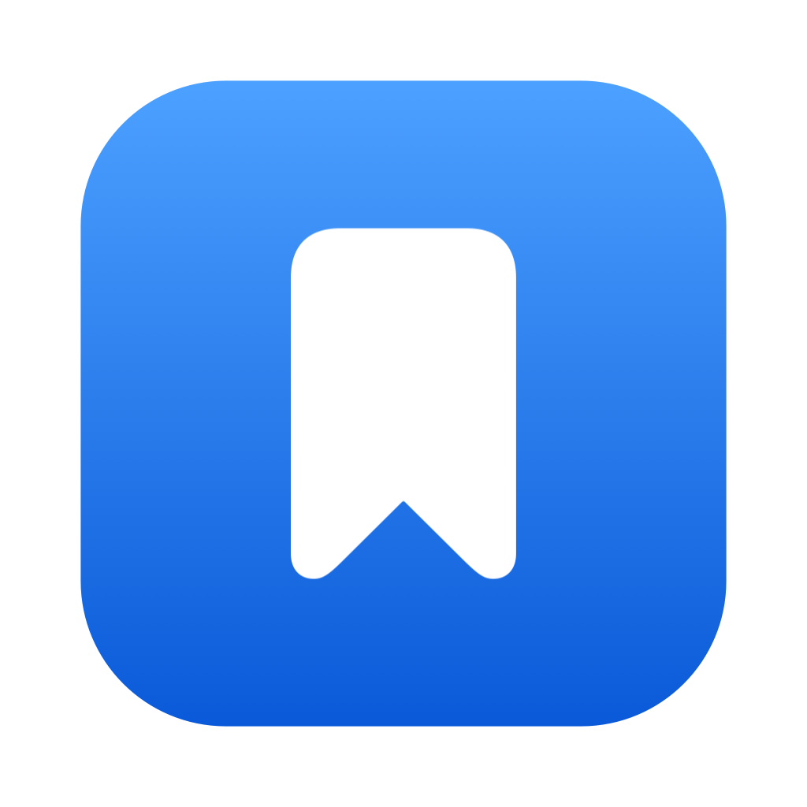

<div align="center">



<h1 align="center">Library</h1>

<p>Everything you open and copy, one shortcut away.</p>

</div>

Library is a menu bar app for macOS. Keep your bookmarks, apps, folders, and terminal commands in one place, open any of them from the menu, a shortcut, or Spotlight, and find what you copied moments ago.

## Requirements

- macOS 26 or later
- Xcode Command Line Tools

## Install

### Download the source

1. Download the latest `Library-x.y.z.zip` from [Releases](https://github.com/deansasek/library/releases). It holds the source, not a built app.
2. Unzip it and open the folder in Terminal.
3. Run `./install.sh`. It builds Library on your Mac and copies it to your Applications folder.

Because you build it yourself, macOS opens it without a security warning.

To update, download the new zip and run `./install.sh` again. Your data is not affected.

### Clone the repository

```bash
git clone https://github.com/deansasek/library.git
cd library
./install.sh
```

To build without installing, run `./build.sh`. The app is written to `build/Library.app`.

To update, run `git pull`, then `./install.sh` again. Your data is not affected.

## Getting started

1. Open Library. A short welcome tour explains the basics and asks for any access it needs.
2. Click the bookmark icon in the menu bar, or press Control-Space for Quick Open.
3. Choose **Edit Library…** to add items. You can also drag an app or a link into the window.
4. Turn on **Open at Login** in **Settings > General** to start Library when you log in.

## Features

### Open anything

Bookmarks, applications, folders, and terminal commands open from the menu bar, a keyboard shortcut, or Spotlight. Hold Option while you click to open an item the other way.

- **Bookmarks** open in a new tab or a new window.
- **Applications** come to the front. An app with launch arguments, such as `--profile work`, starts a new instance.
- **Terminal commands** run in a login shell in a new Terminal window. Add only commands you trust.

Each item shows its URL, command, or path when you hover over it.

### Find it fast with Quick Open

Press Control-Space to open a search field over every item.

- Type words from a name, keyword, URL, or folder. Press ↑ or ↓ to choose a result, then press Return.
- Type or paste a web address to open it or add it to your library. Type anything else to search Google.
- Type a calculation, such as `12*8`, or a conversion, such as `5 km in miles` or `72 f to c`. Press Return to copy the answer.
- Press Tab, or right-click a result, to open it the other way, copy its link, path, or command, or show an app in Finder.
- Press ⌘1 through ⌘9 to open the first nine results.

### Keep what you copy

Library remembers what you copy, including text, links, images, and files, in every format you copied them in.

- Open the **Library** menu or Quick Open to see your latest copies. Choose one to copy it again.
- Pin an item to keep it after you quit Library.
- Press Control-Command-V to open the clipboard menu at the pointer. Press 1 through 9 to copy an item. Hold Option to copy it as plain text.
- Choose an item in the clipboard menu or Quick Open while a text field has the keyboard, and Library pastes it there. Otherwise it copies the item. Menu headers say "Paste" when it will paste. Turn this off with **Paste Into Text Fields** in **Settings > Clipboard**. Pasting needs Accessibility access.
- Library skips anything a password manager marks as private.
- Copies over 25 MB are skipped.

### Add from the clipboard

When you select a link in the app in front, or copy a link or an app that isn't in your library, the Library menu, the clipboard menu, and Quick Open offer to add it. A selected link comes first. Reading a selection needs Accessibility access.

### Organize your library

Choose **Edit Library…** to manage your items in the Library window.

- Add bookmarks (⌘N), folders (⇧⌘N), applications, commands, and dividers from the **+** menu.
- Drag an app from Finder or a link from your browser into the window to add it.
- Select several rows with ⌘-click or ⇧-click. Drag rows to reorder them or move them into a folder.
- Right-click a row to open it, show it in Finder, get info, rename, move, share, or delete it. Press Return to rename the selected row.
- Use ⌘Z to undo and ⇧⌘Z to redo changes. Undo history lasts until you quit.

A divider appears as a titled section in the menu. The items below it belong to that section.

### Get Info

Select an item and press ⌘I, or choose **Get Info** from the toolbar or a right-click menu. The form sets:

- **Name** and **icon.** Pick an SF Symbol, choose an emoji, or keep the default icon, which is the site's favicon or the app icon.
- **URL or command.**
- **Opens In.** Choose how a click opens the item.
- **Browser.** Choose which browser opens a bookmark, or keep the default.
- **Keywords.** Extra words that help Quick Open and Spotlight find the item, such as `tix` for Jira.
- **Color.** A colored dot appears on the icon in the menu, Quick Open, and the Library window. Type the color name in Quick Open to find tagged items.
- **Shortcuts.** Add one or more shortcuts for the item.
- **Open When You Log In.** Opens the item a few seconds after you log in.

### Ask for a value

Turn a bookmark into a template. Put `{}` where the value goes in the URL. When you open the bookmark, Library asks for the value and fills it in. For example, a ticket number. Library encodes the value for the URL.

### Choose what a click does

**Opens In** sets how a click opens an item.

- Bookmarks open in a new tab or a new window. New window works with Firefox and Chrome-based default browsers. Other browsers open a new tab.
- Applications come forward, or start a new instance.

### Shortcuts

Shortcuts work from any app. Each one can be:

- A key combination. It must include Control, Option, or Command.
- A modified click, such as Control-click or right-click with a modifier.
- A scroll, a pinch, or a swipe, with at least one modifier.
- A hot corner. It opens when the pointer reaches a screen corner.

An item can have several shortcuts, each with its own behavior. Library shows a warning when a shortcut is already used by another app.

The defaults are Control and right-click to open the menu, Control-Space for Quick Open, and Control-Command-V for the clipboard menu. Restore them at any time in **Settings > Shortcuts**.

### Frequently Used

After you open an item twice or more, it moves to the top of the menu and Quick Open. The five most used items appear first. Usage counts are kept in your macOS preferences.

### Share and drag out

Right-click a bookmark or app and choose **Share…** to use the macOS share sheet. Drag a row into any app to drop its link or app file there.

### Keep your library in sync

Library reloads `bookmarks.json` when another program changes it, such as an editor or `git pull`. A file Library can't read is ignored.

### Use Library from other apps

- **Spotlight:** Bookmarks, apps, and commands appear in Spotlight results.
- **Services:** Select a link in any app, then choose **Services > Add to Library**. In Finder, select applications or folders and choose **Services > Add to Library** to add them. Apps already in your library are skipped. Folders are added as empty groups.
- **URL scheme:** Use `library://open?name=Jira&value=ABC-123` to open a bookmark or app and fill in its template. Terminal commands can't be opened this way, so a web page can't run one. Use `library://menu` to show the menu. Use `library://search` to open Quick Open.

From Terminal, run `open "library://open?name=Jira&value=ABC-123"`.

### Welcome tour

The welcome tour opens the first time you launch Library. It explains the app and lets you try each shortcut. To see it again, choose **Settings > General > Welcome Screen > Show…**.

## Settings

**Settings** (⌘,) has three tabs.

- **General:** Open at Login, the welcome screen, and the app version.
- **Shortcuts:** One list of shortcuts: Show Library Menu, Show Quick Open, Show Clipboard Menu, and Open Copied Link. A picker sets whether the Library menu opens at the pointer or from the menu bar.
- **Clipboard:** Turn clipboard history, pasting into text fields, and copied GIFs on or off, and clear the history.

## Privacy

Library stores your library and clipboard history on your Mac. Unpinned clipboard history stays in memory and is cleared when you quit. It connects to the internet only to load favicons from your bookmarked sites, to search Google when you ask, and, if you turn on **Play Copied GIFs** in **Settings > Clipboard** (off by default), to download a GIF you copied from a web page so it can play.

Your data is stored in `~/.library/`:

| File | Contents |
| --- | --- |
| `bookmarks.json` | Your items, folders, shortcuts, and order |
| `clipboard.json` | Pinned clipboard items, readable only by you |
| `favicons/` | Cached site icons. Library downloads them again if you delete the folder. |

If Library can't read `bookmarks.json`, it saves a copy as `bookmarks-damaged.json` and tells you when it launches.

Updates don't change this data.

## Permissions

- **Keyboard shortcuts** and **hot corners** don't need any permission.
- **Click, scroll, pinch, and swipe shortcuts** and **suggesting a selected link** need Accessibility access. Turn it on in **System Settings > Privacy & Security > Accessibility**. Library reads your selection only when you open one of its menus, looks for a link in it, and doesn't keep it.

## Troubleshooting

- **A shortcut doesn't work.** Another app may use the same keys. Check **Settings > Shortcuts** for a conflict. Control-Space can conflict with the macOS input source shortcut.
- **Clicks stop working after a macOS update.** Remove Library from Accessibility, then add it again.
- **Open at Login has no effect.** Move `Library.app` to `/Applications` first. The login item stores the app's location.
- **Services don't appear.** Log out and back in, or run `/System/Library/CoreServices/pbs -update`.

## Development

- `./build.sh` builds the app.
- `./test.sh` runs the checks in `Tests/` against the app's source. They use private pasteboards and temporary files, so they never touch your clipboard or your library.
- Every pull request, and every push to `main`, builds the app and runs the checks on GitHub Actions.

## Releasing

Push a tag to publish a release:

```bash
git tag v1.2.0
git push origin v1.2.0
```

You can also run the **Release** workflow by hand and give it a version. Either way, GitHub Actions builds the app and runs the checks, to be sure the version is sound, then publishes `Library-1.2.0.zip`. The zip is the source, not a built app. It holds only what is needed to build: `Sources/`, `Resources/`, `Package.swift`, `build.sh`, `install.sh`, and this README. The tests, workflows, docs, and icon script are left out. `.gitattributes` sets that list, and GitHub's own source archives follow it too.
